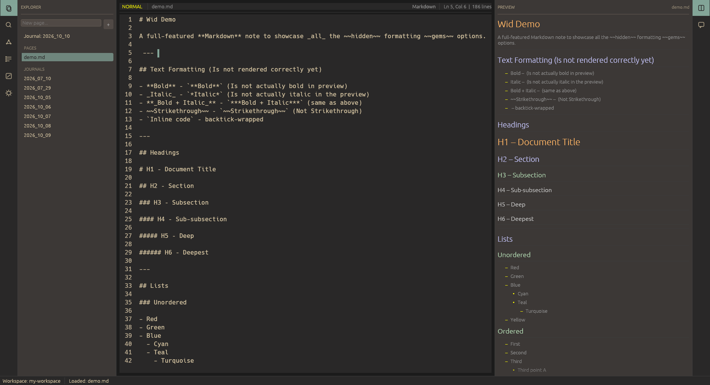

# Wid - "Write It Down".

A local-first knowledge workspace built with Rust and egui.

Markdown files are the source of truth. Vim is the primary interaction model. Everything works offline.

Inspired by Logseq, Emacs, Penpot and Zed.



## Current Status — v0.1 MVP

- [x] Workspace creation (pages, journals, assets)
- [x] Journal-first workflow (opens today's journal on launch)
- [x] Vim modal editing (normal, insert, visual, command-line)
- [x] Vim motions: h/j/k/l, w/b/e, W/B/E, 0/$/^, gg/G, {/}, %, f/F/t/T, ;/,
- [x] Vim operators: d/y/c with motion composition (d3w, yip, di(, etc.)
- [x] Vim text objects: iw, aw, ip, i( / a(, i[ / a[, i{ / a{, i" / a", i' / a'
- [x] Visual mode (charwise, linewise) with d/y/c/~/></ <
- [x] Count support (3j, 5w, d2w, etc.)
- [x] Registers ("a-"z, unnamed, small-delete)
- [x] Undo / redo (u, Ctrl+r)
- [x] Search (/pattern, ?pattern)
- [x] Command-line mode (:w, :q, :wq, :q!, :wq!, :e, :help, :noh)
- [x] Markdown preview (toggleable)
- [x] Sidebar with pages and journal list
- [x] Ctrl+f / Ctrl+b page scrolling

## Vim Normal Mode

| Key             | Action                              |
| --------------- | ----------------------------------- |
| `h`/`j`/`k`/`l` | Move cursor                         |
| `i`/`I`         | Insert at cursor / line start       |
| `a`/`A`         | Append after cursor / line end      |
| `o`/`O`         | Open line below / above             |
| `w`/`b`/`e`     | Word forward / back / end           |
| `W`/`B`/`E`     | WORD forward / back / end           |
| `0`/`$`/`^`     | Line start / end / first non-blank  |
| `gg`/`G`        | File start / end                    |
| `{`/`}`         | Paragraph back / forward            |
| `%`             | Matching bracket                    |
| `f`/`F`/`t`/`T` | Find char forward / back / till     |
| `Ctrl+f`/`Ctrl+b` | Page down / page up               |
| `PageUp`/`PageDown` | Page up / page down             |
| `;`/`,`         | Repeat last find / reverse          |
| `dd`/`yy`/`cc`  | Delete / yank / change line         |
| `d{motion}`     | Delete with motion (d3w, di(, etc.) |
| `y{motion}`     | Yank with motion                    |
| `c{motion}`     | Change with motion                  |
| `p`/`P`         | Paste after / before                |
| `x`             | Delete character                    |
| `r`             | Replace character                   |
| `~`             | Toggle case                         |
| `J`             | Join lines                          |
| `>`/`<`         | Indent / outdent                    |
| `u`/`Ctrl+r`    | Undo / redo                         |
| `.`             | Repeat last change                  |
| `v`/`V`         | Visual charwise / linewise          |
| `"x`            | Select register for next op         |
| `:`             | Command-line mode                   |
| `/`/`?`         | Search forward / backward           |

## Workspace Layout

```
workspace/
├── workspace.toml      # name, created_at
├── pages/              # user pages (.md)
└── journals/           # daily journals (YYYY_MM_DD.md)
```

## Architecture

```
App (ui.rs)          — panels, menus, sidebar
│
├── widget            — egui → KeyPress bridge, buffer painting
├── editor (no egui)  — Buffer, Selection, cursor math, text objects
├── vim (no egui)     — VimState, Mode, Registers, operators, commands
├── workspace         — file I/O, workspace scan, config
└── preview           — pulldown-cmark → egui renderer
```

Dependencies only flow downward. The editor and vim modules contain zero egui imports — they can be tested independently.

## Build

```bash
cargo run              # debug
cargo run --release    # release
```

## Roadmap

### v0.2 — Local AI

- [ ] Ollama / llama.cpp provider
- [ ] Embeddings + retrieval
- [ ] Agent panel (research, writer, journal reflection)
- [ ] Context assembly from current page + links + journals
- [ ] Optional self-hostedSearxng Support

### v0.3 — Graph

- [ ] Page graph visualization
- [ ] Block references ((block-id))
- [ ] Backlinks panel
- [ ] Workspace dashboards

### v1.0 — Stable

- [ ] Git integration (commit, diff, revert, auto-commit)
- [ ] [[Page]] wikilink navigation
- [ ] #tag aggregation
- [ ] Stable workspace format
- [ ] Stable markdown compatibility
- [ ] Fully offline operation
- [ ] Documented architecture

### Journal date format

The journal file naming convention is `YYYY_MM_DD.md` (e.g., `2026_06_09.md`). This follows the Logseq convention and is open to discussion before 1.0.

## Non-Goals

Wid will NOT become:

- Notion / Obsidian / Roam clone
- Electron or web application
- Team collaboration platform
- SaaS product
- Plugin marketplace

## Installing Wid on NixOS

Wid ships a flake with a package, a NixOS module and a Home Manager module. `x86_64-linux` only for now.

### Quick try (no install)

```bash
nix run git+https://codeberg.org/Wid-Notes/Wid-Notes
```

### Install into your profile

```bash
nix profile add git+https://codeberg.org/Wid-Notes/Wid-Notes#wid
wid
```

### NixOS module (declarative)

Add the input to your system flake:

```nix
{
  inputs.wid.url = "git+https://codeberg.org/Wid-Notes/Wid-Notes";
}
```

Then enable it in your host configuration:

```nix
{ inputs, ... }:

{
  imports = [ inputs.wid.nixosModules.wid ];

  programs.wid.enable = true;
}
```

### Home Manager module

```nix
{ inputs, ... }:

{
  imports = [ inputs.wid.homeManagerModules.wid ];

  programs.wid = {
    enable = true;
    stylix.enable = true;   # default: generate ~/.config/wid/theme.toml from your Stylix scheme
  };
}
```

Set `programs.wid.stylix.enable = false` if you don't use Stylix or prefer your own `theme.toml`.

### Development environment

```bash
nix develop          # full shell: cargo, just, cargo-watch, rust-analyzer, mold
just check           # cargo check via the flake (system cargo is a rustup proxy on NixOS)
just ci              # fmt + clippy + check
nix build            # release build through crane
```

> The flake's dev shell pins Mesa/Vulkan ICDs (`VK_DRIVER_FILES`) so the GUI starts against the shell's own libraries instead of mismatched system glibc.

## License

[MIT](LICENSE)
